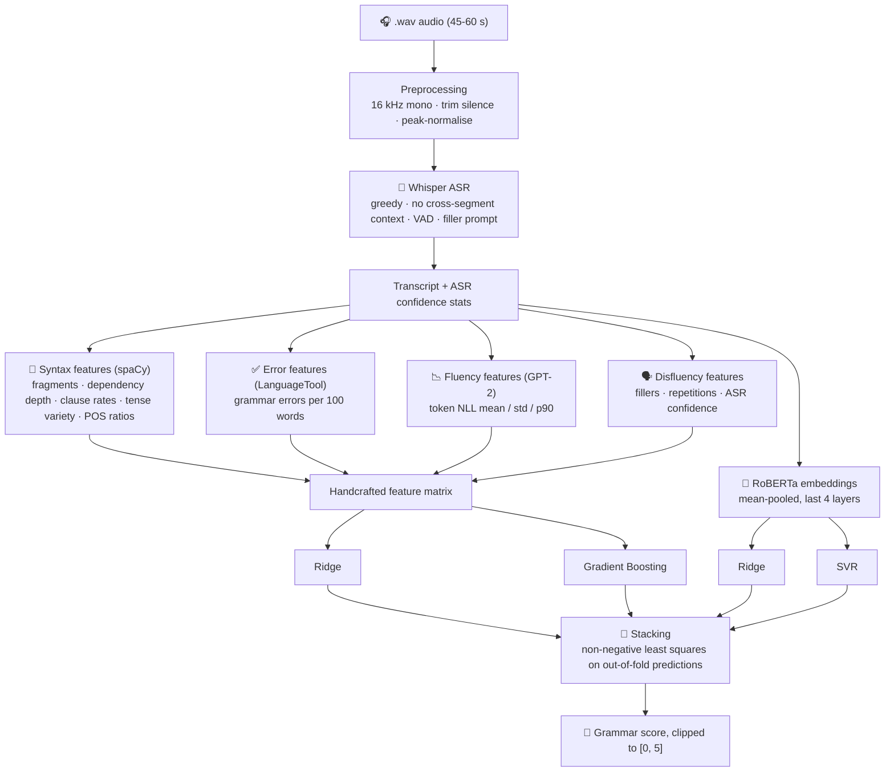

<div align="center">

# 🎙️ Grammar Scoring Engine for Spoken English

### Predict a 0–5 grammar score straight from a 45–60 second audio clip

**Speech → Text → Linguistic Features + Transformer Embeddings → Stacked Ensemble → Score**


</div>

---

## ✨ TL;DR

Given a spoken sample, the engine outputs a **continuous grammar score from 0 to 5** that follows a MOS-style Likert rubric
(from *"struggles with basic sentence structure"* to *"high accuracy and control of complex grammar"*).

Grammar is a **lexical and syntactic** property, not an acoustic one. Pitch, pauses and speech rate say little about whether a sentence is well formed. So instead of feeding raw audio embeddings to a regressor, this project **transcribes the speech and models the language itself**, using:

- 🔬 **Interpretable grammar features** that map directly to the scoring rubric
- 🧠 **Pretrained contextual embeddings** that capture patterns no one hand-coded
- 🧮 **A stacked ensemble** that learns how much to trust each signal

> Training set: **769** labelled clips · Test set: **216** clips · Metric: **RMSE** (plus MAE, Pearson, Spearman, QWK)

---

## 🏗️ Pipeline Architecture



---

## 🧩 Components Explained

### 1. Preprocessing
| Step | Why |
|---|---|
| Resample to 16 kHz mono | Required input format for Whisper |
| Trim leading/trailing silence (`top_db=30`) | Removes dead air that can trigger ASR hallucinations |
| Peak normalisation | Consistent loudness across recordings |
| Whisper VAD filter | Skips non-speech regions |

### 2. Speech-to-Text (Whisper via `faster-whisper`)
ASR models tend to **silently "repair" grammar and drop filler words**, which would hide exactly the signal we want to score. To reduce that effect:
- **Greedy decoding** (temperature 0) so the output stays close to what was said
- **`condition_on_previous_text=False`** so earlier text can't be used to "fix" later sentences
- A short **filler-word prompt** that encourages Whisper to keep "um / uh"
- **ASR confidence statistics** (avg log-prob, compression ratio, no-speech prob) are kept as features, since broken or unusual speech often lowers confidence

Transcripts are cached to disk, so the slow step runs only once.

### 3. Feature Engineering, mapped to the rubric

| Rubric signal | Feature group | Tooling |
|---|---|---|
| Incomplete sentences, fragments (score 1–2) | Share of sentences with no verb / no subject, sentence-length stats | spaCy |
| Basic grammar mistakes (score 2–3) | Grammar-error rate per 100 words | LanguageTool |
| Overall fluency and well-formedness | Token negative log-likelihood (mean, std, p90, share of surprising tokens) | GPT-2 |
| Complex structures (score 4–5) | Dependency-tree depth, subordinate / relative / passive / coordination rates, modal use, tense variety | spaCy |
| Self-correction and control | Filler rate, immediate word repetitions | Rule-based |
| Recognition quality | ASR confidence stats, duration, segment count | Whisper |
| Lexical profile | Type–token ratio, POS distribution, word length | spaCy |

LanguageTool categories about writing conventions (casing, punctuation, typography, style) are **filtered out**, because they are meaningless for transcribed speech.

### 4. Contextual Embeddings
`roberta-base` hidden states (average of the last 4 layers, attention-masked mean pooling) give a dense summary of the transcript. This catches grammatical patterns the handcrafted features miss.

### 5. Stacked Ensemble
Four small, strongly regularised regressors suit a dataset of under 1k samples:

| Model | Input |
|---|---|
| Ridge (CV-tuned α) | RoBERTa embeddings |
| SVR (RBF) | RoBERTa embeddings |
| Ridge (CV-tuned α) | Handcrafted features |
| HistGradientBoosting (shallow, L2) | Handcrafted features |

Blend weights come from **non-negative least squares on inner 5-fold out-of-fold predictions**, computed only on the training portion, so validation and test data never influence them. The output is clipped to `[0, 5]`.

---

## 📊 Evaluation Protocol

| Split | Purpose |
|---|---|
| 80/20 stratified holdout | Train RMSE and validation RMSE |
| 5-fold stratified CV (full train set) | Out-of-fold RMSE, the most honest generalisation estimate |
| Final model on all 769 samples | **Full-train RMSE** and test-set predictions |

Metrics: **RMSE** (primary), MAE, Pearson, Spearman and Quadratic Weighted Kappa (on rounded scores).

### 🏆 Results

> Fill in after running the notebook (section 9 prints this table automatically).

| Split | RMSE | MAE | Pearson | Spearman | QWK |
|---|---|---|---|---|---|
| Train split (80%) | – | – | – | – | – |
| Validation split (20%) | – | – | – | – | – |
| 5-fold CV (out-of-fold) | – | – | – | – | – |
| **Full training set (final model)** | **–** | – | – | – | – |
| Naive baseline (predict the mean) | – | | | | |

The test set has no public labels, so only predictions are produced (`test_predictions.csv`).

---

## 🔍 Interpretability

The notebook ships with the plots needed to understand *why* the model predicts what it does:

- Label distribution
- Spearman correlation of each linguistic feature with the score
- **Ablation chart:** embeddings only vs. features only vs. ensemble vs. baseline
- Predicted vs. true scatter (validation and out-of-fold)
- Residual distribution
- Permutation importance of handcrafted features
- Worst out-of-fold predictions with their transcripts, for error analysis

---

## 🚀 Quickstart

### 1. Environment (mamba / conda)
Java is installed inside the environment, because LanguageTool needs it (Java 17 or newer).

```bash
mamba create -n grammar -c conda-forge python=3.11 openjdk=17 ffmpeg -y
mamba activate grammar

mamba install -c conda-forge -y numpy pandas scipy scikit-learn matplotlib seaborn \
    tqdm joblib tabulate librosa soundfile spacy transformers jupyterlab ipykernel
pip install faster-whisper language_tool_python torch

python -m spacy download en_core_web_sm
python -m ipykernel install --user --name grammar --display-name "Python (grammar)"
```

> **GPU:** NVIDIA GPUs speed up transcription a lot. On CPU, set `WHISPER_SIZE = "base.en"` in the config cell.

### 2. Data layout
```
.
├── Grammar_Scoring_Engine.ipynb
├── data/
│   ├── train/            # training .wav files
│   ├── test/             # test .wav files
│   ├── train.csv         # columns: filename, label
│   └── test.csv          # column: filename (label optional)
```
Paths and column names can be changed in the configuration cell at the top of the notebook.

### 3. Run
```bash
jupyter lab
```
Open the notebook, select the **Python (grammar)** kernel, skip the first `pip install` cell, and **Run All**.

**Outputs**
- `test_predictions.csv`: predicted grammar scores for the test set
- `artifacts/`: cached transcripts, features and the trained model (`grammar_model.joblib`)
- RMSE and the full metric tables printed in the notebook

### 4. Score a single recording
```python
score, transcript = predict_grammar_score("path/to/audio.wav")
print(f"Grammar score: {score:.2f}/5")
```

---

## ⚠️ Limitations

- ASR can normalise grammar errors and hide them. This is mitigated, not eliminated.
- spaCy and LanguageTool are trained on written text, so they make some mistakes on spoken transcripts.
- MOS labels are subjective, and rater noise sets a floor on achievable RMSE.
- Very short or empty transcripts give unreliable features.

## 🔭 Future Work

- Fine-tune **DeBERTa-v3** end-to-end on transcripts with an RMSE loss
- Use a **grammatical error correction** model and take the edit distance between transcript and correction as a feature
- Add Whisper-encoder / wav2vec2 embeddings as one more ensemble member, to test whether acoustics add anything
- Ordinal-regression loss and multi-ASR ensembling

---

## 📁 Repository Structure

```
├── Grammar_Scoring_Engine.ipynb   # full pipeline + report
├── test_predictions.csv           # generated predictions
├── artifacts/                     # cached transcripts, features, model
└── README.md
```

---

<div align="center">

**If this helped you, a ⭐ on the repo is appreciated.**

</div>
